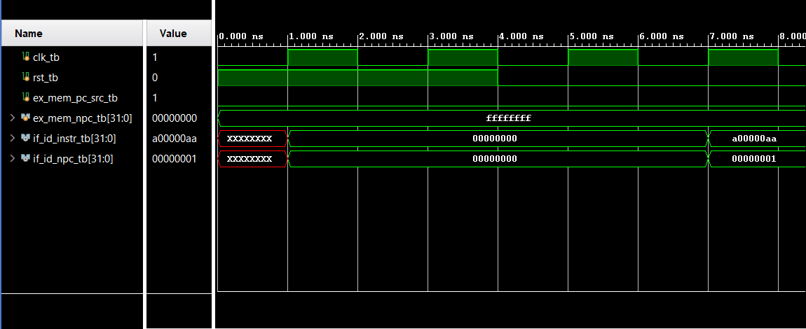
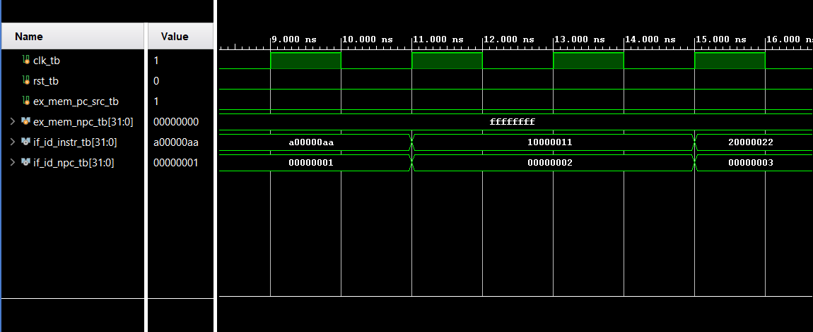
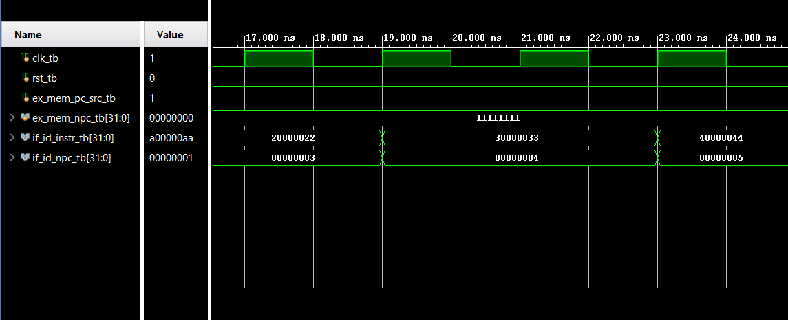
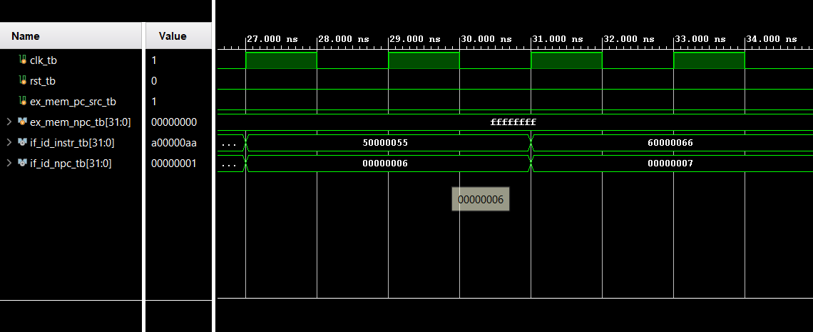
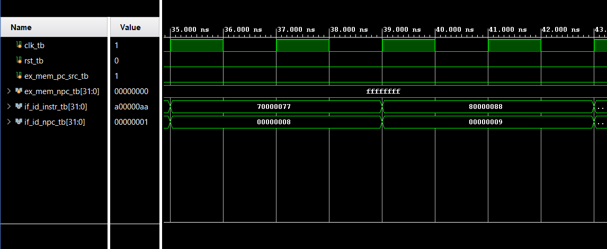
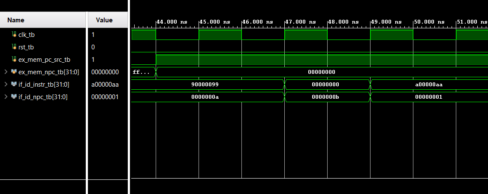

# ECE4300
Computer Architecture

# Lab 1 — Instruction Fetch Stage and IF/ID Pipeline Register

## Design Scope and Assumptions
- **In scope:** Implements the Instruction Fetch(IF) stage of a pipelined CPU, including the 32-bit Program Counter (PC) register, PC incrementer (adder by 1), Next-PC selection multiplexer, Instruction Memory, and the pipeline IF/ID latch register. 
- **Out of scope:** Instruction decoding, ALU operations, execution/memory/writeback stages, hazard detection unit, and flush/stall control signals for the IF/ID register. 
- **Assumptions:**
	-Word-addressable instruction memory where the PC increments by `1` per instruction 
	-Active-high synchronous logic triggered on the rising edge of `CLK`. 
	-PC is updated every clock cycle with either `PC + 1` or `PC_from_ExMem` based on the control signal `PCSrc`. 
- **Limitations:** Fixed-size instruction memory with fixed instructions without dynamic loading or cache stall capabilities. 
## Requirements
| Requirement | Description | Verification Method |
|---|---|---|
| REQ-01 | The PC register shall update its output on every rising clock edge based on the input selected by the multiplexer. | Waveform inspection (Waveform1.png) |
| REQ-02 | The adder shall continuously output `PC + 1` to drive normal sequential instruction fetching and feed the IF/ID register.  | Calculation  |
| REQ-03 | The 2-to-1 Mux shall select `PC + 1` when `PCSrc = 0` and `PC_from_ExMem` when `PCSrc = 1`. | Waveform inspection  (Waveform5.png & Waveform6.png|
| REQ-04 | The Instruction Memory shall output the 32-bit instruction word stored at the current `PC` address.  | Waveform inspection (Waveform1.png) |
| REQ-05 | The IF/ID Latch shall capture the incremented PC (`PC + 1`) and fetched instruction on the rising edge of `CLK`.  | Waveform inspection (Waveform1.png) |

## Architecture
### Timing or Behavioral Summary
Save diagrams in the repository's `images/` folder. Use relative paths so they
display on GitHub.







## Implementation
### Source Code
| File | Description |
|---|---|
| [`fetch_tb.v`](fetch_tb.v) | Testbench for simulating the top-level module `fetch.v`
| [`fetch.v`](fetch.v) | Top-level module integrating PC, Mux, Adder, Instruction Memory, and IF/ID Register | 
| [`pc.v`](pc.v) | 32-bit synchronous Program Counter register | 
| [`adder.v`](adder.v) | 32-bit adder module computing `PC + 1` | 
| [`mux.v`](mux.v) | 32-bit 2-to-1 multiplexer controlled by `PCSrc` | 
| [`mem.v`](mem.v) | Synchronous/asynchronous read instruction memory block | 
| [`if_id.v`](if_id.v) | Pipeline latch storing `PC + 1` and fetched instruction for ID stage | 


### Implementation Notes
- **Word Addressability:** The PC adder increments by `1` rather than `4`, reflecting a word-aligned memory model. 
- **Pipeline Synchronization:** The IF/ID register guarantees that both the sequential target PC (`PC + 1`) and the instruction payload are aligned for downstream instruction execution and relative branch calculations. 
- **Control Signal Alignment:** `PCSrc = 1` forces a PC jump to the branch target generated in later execution/memory stages (`PC_from_ExMem`). 

## Verification
### Verification Strategy
The design is verified using **simulation**.
Verification covers:
- Normal operating case
- Reset or initialization case
### Testbench and Waveform
Save screenshots and waveform images in the repository's `images/` folder.

The testbench source is available [*here*](fetch_tb.v).
### Results
| Test Case | Expected Result | Observed Result | Status |
|---|---|---|---|
| TC-01 — Reset Active | PC, Latch, and Instr. Mem should all be 0 with Reset at 1 | Behaved as expected | Pass |
| TC-02 — PC Incrementing | PC incrementing by 1 as fetch increments through memory only on rising edge  | Behaved as expected | Pass |
| TC-03 — PCSrc = 1, PC redirected to NPC = 0 | Mux selects EX_MEM_NPC and PC repeatedly loads 0 | Behaved as expected | Pass |
| TC-04 — PCSrc = 0 | Mux selects PC + 1 again and PC begins incrementing | Behaves as expected | Pass |

## Reproduction Instructions
### Tools and Versions
- **Simulator / synthesis tool:** Xilinx Vivado
- **Language / standard:** IEEE 1364-2001 Verilog 
- **Operating system:** Windows
- **Additional dependencies:** N/A


## Repository Organization
```text
.
├── README.md
├── Images/
│ ├── Waveform1.png
│ ├── Waveform2.png
│ ├── Waveform3.png
│ ├── Waveform4.png
│ ├── Waveform5.png
│ └── Waveform6.png
├── adder.v
├── adder_tb.v
├── fetch.v
├── fetch_tb.v
├── if_id.v
├── if.id_tb.v
├── mem.v
├── mem_tb.v
├── mux.v
├── mux_tb.v
├── pc.v
├── pc_tb.v
└── 
```
